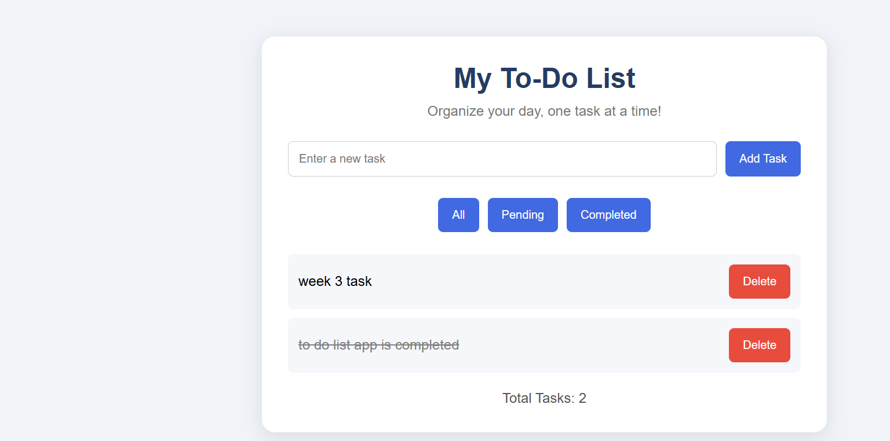
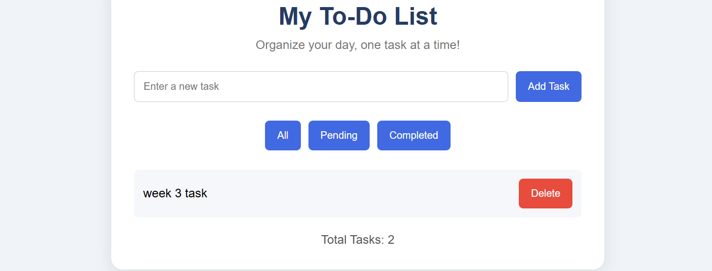
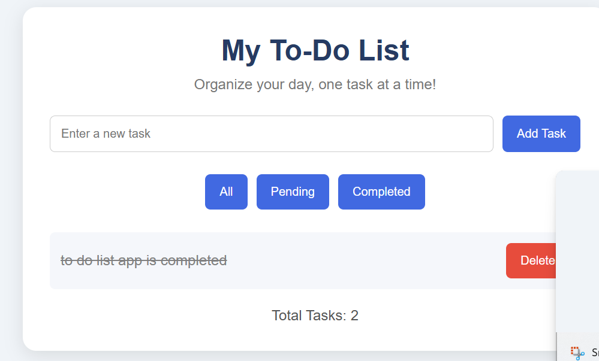

React To-Do App

A simple and responsive To-Do List application built using React and Vite. It helps users organize daily tasks and track their progress.

Features

- Add new tasks
- Mark tasks as completed
- Delete tasks
- Filter tasks by All, Pending, and Completed
- Save tasks using Local Storage
- Responsive user interface

Technologies Used

- React.js
- JavaScript
- HTML
- CSS
- Vite
- Browser Local Storage

Project Structure

react-todo-app/
├── public/
├── src/
│   ├── components/
│   │   ├── Header.jsx
│   │   ├── TodoForm.jsx
│   │   ├── TodoItem.jsx
│   │   └── TodoList.jsx
│   ├── App.jsx
│   ├── App.css
│   ├── index.css
│   └── main.jsx
├── index.html
├── package.json
└── vite.config.js

How to Run the Project

1. Clone the repository.

2. Install dependencies:
   
   "npm install"

3. Start the development server:
   
   "npm run dev"

4. Open the localhost link in your browser.

Learning Outcomes

- Learned React components and props.
- Understood state management using "useState".
- Used "useEffect" to save tasks in Local Storage.
- Practiced event handling and conditional rendering.
- Built a responsive application using React.

Author

Khairunnisa Athani

Computer Science and Engineering Student
## Output Screenshots

### Add Task

### Pending Task

### Completed Task

